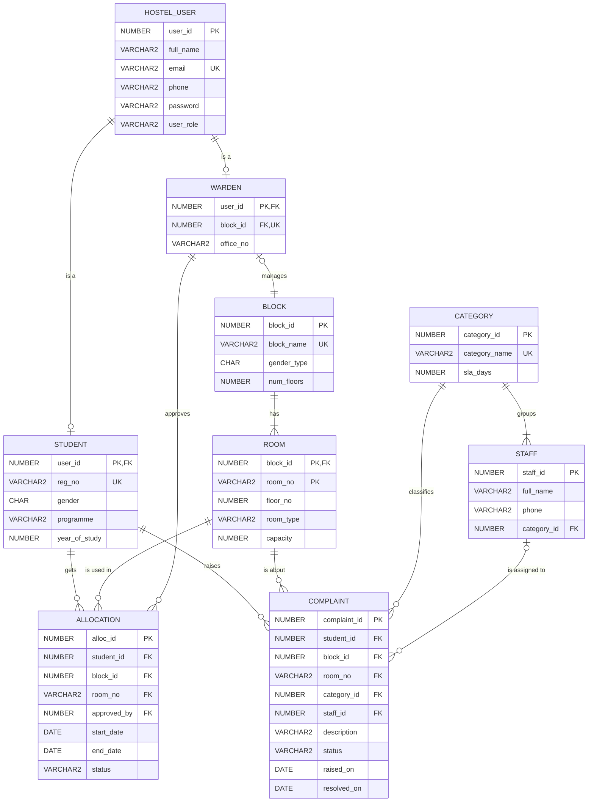

# Database design

This document describes the Oracle schema in `sql/01_schema.sql` to `sql/03_triggers.sql`. The schema follows the approved Phase 1 design (PRD section 5).

## ER diagram

STUDENT and WARDEN are subclasses of HOSTEL_USER (mapping option 8A). ROOM is a weak entity of BLOCK. Its key is (block_id, room_no).

## Tables

| Table | Key | Main rules |
| --- | --- | --- |
| HOSTEL_USER | `user_id` (identity) | Email is unique and has a basic email format. Phone has 10 digits. Role is STUDENT or WARDEN. Password holds a PBKDF2 hash. |
| STUDENT | `user_id` (FK to HOSTEL_USER, ON DELETE CASCADE) | Reg no is unique, for example `25BCE0231`. Gender is M or F. Year is 1 to 5. |
| BLOCK | `block_id` (identity) | Name is unique. Gender type is M or F. Floors are 1 to 20. |
| WARDEN | `user_id` (FK to HOSTEL_USER, ON DELETE CASCADE) | `block_id` is unique, so one warden manages one block (BR-4). |
| ROOM | (`block_id`, `room_no`) | Type is SINGLE, DOUBLE, TRIPLE or QUAD. Capacity agrees with the type (1, 2, 3 or 4). |
| ALLOCATION | `alloc_id` (identity) | Status is ACTIVE (no end date) or VACATED (with an end date). The end date is not before the start date. |
| CATEGORY | `category_id` (identity) | Name is unique. `sla_days` is more than 0. |
| STAFF | `staff_id` (identity) | Each staff member belongs to one category. |
| COMPLAINT | `complaint_id` (identity) | Description has 10 characters or more. Status is OPEN, IN_PROGRESS or RESOLVED. `resolved_on` is set only when RESOLVED, and is not before `raised_on`. Work cannot start without assigned staff. |

All 86 constraints have names with the prefixes `pk_`, `fk_`, `uq_` and `ck_`. The NOT NULL constraints are named `ck_<table>_<column>_nn`. The unique index `ux_alloc_one_active` allows one ACTIVE allocation per student (BR-2).

When two CHECK constraints fail on the same row, Oracle reports the last one in the table definition. For this reason, the combined checks (for example `ck_room_capacity_type`) come before the single-column checks. Then the error names the most exact rule.

## Triggers

| Trigger | When | Rule | Error |
| --- | --- | --- | --- |
| `trg_alloc_capacity` | After each INSERT or UPDATE statement on ALLOCATION | BR-1: no room has more ACTIVE allocations than its capacity | ORA-20001 |
| `trg_alloc_gender` | Before each inserted ALLOCATION row | BR-3: the student gender agrees with the block gender | ORA-20003 |
| `trg_alloc_warden_block` | Before each inserted ALLOCATION row | BR-4: the warden who approves manages the block | ORA-20004 |
| `trg_complaint_staff_cat` | Before each COMPLAINT row is inserted or its `staff_id` changes | The staff category agrees with the complaint category | ORA-20005 |

`trg_alloc_capacity` is a statement-level trigger. A row-level trigger cannot read ALLOCATION while ALLOCATION changes (ORA-04091, mutating table).

## Views

| View | Contents |
| --- | --- |
| `V_ROOM_OCCUPANCY` | Each room with its capacity, occupancy (the count of ACTIVE allocations) and vacancies. Occupancy is not stored. |
| `V_OVERDUE_COMPLAINTS` | Each complaint that is not RESOLVED and is older than the `sla_days` of its category, with names and `days_overdue` (BR-6). |

## Sample data

`sql/04_seed.sql` adds 3 blocks, 3 wardens, 5 categories, 8 staff, 36 rooms, 45 students (30 male, 15 female), 42 allocations (38 ACTIVE, 4 VACATED) and 15 complaints. Dates are relative to SYSDATE, so some complaints are always overdue.

## A note on normal form

In ROOM, `room_type` decides `capacity`. Thus `capacity` depends on a column that is not a key. This is a transitive dependency, so ROOM is not strictly in 3NF. The approved Phase 1 design keeps `capacity` as a column. The constraint `ck_room_capacity_type` makes sure that the two values always agree.
